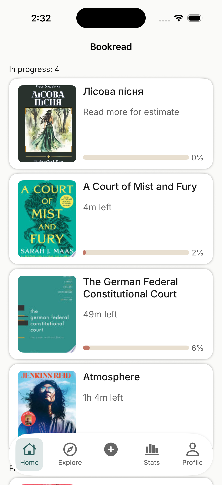
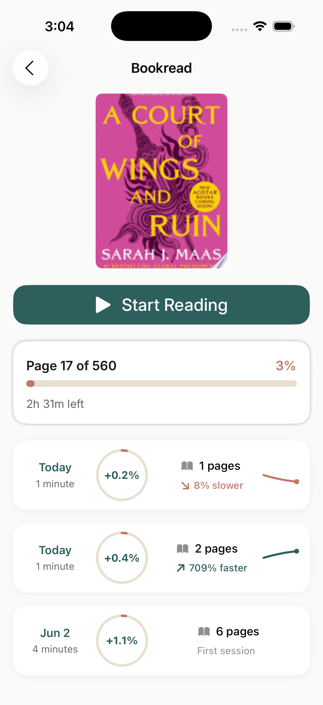
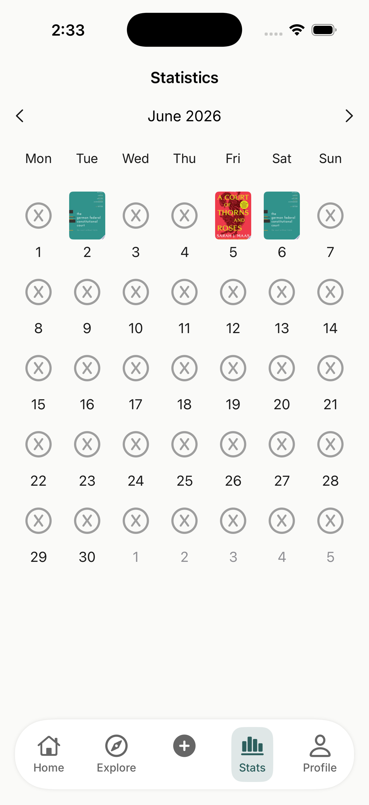
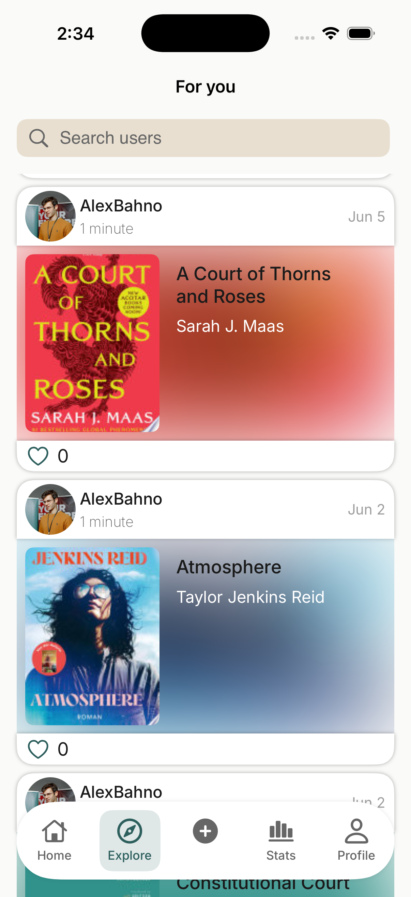

# 📚 Bookread

**A social reading tracker for iOS** — log reading sessions with a built-in timer, scan books by ISBN, track your progress with monthly statistics, and follow friends to see what they're reading.

Bookread was developed as my Bachelor's thesis at Oles Honchar Dnipro National University (*"Development of a mobile application for social interaction of readers and tracking of reading progress"*, defended in 2026).

<p align="center">
  <!-- Replace with your own screenshots / GIF -->
  
  
  
  
</p>

<p align="center">

  
https://github.com/user-attachments/assets/c7be5900-ea52-4576-a8ca-62e499631349


</p>

---

## ✨ Features

- **Reading timer** — start, pause and finish a reading session; pages read and time spent are saved automatically
- **Add books in three ways** — search via the Google Books API, scan an ISBN barcode with the camera (VisionKit `DataScannerViewController`), or create a custom book with your own cover
- **Statistics** — monthly calendar with daily reading activity, reading history and per-book progress
- **Social feed** — follow other readers, see their reading sessions and like them
- **Profiles** — followers / following, editable profile with photo upload, user search
- **Authentication** — email & password and Sign in with Google, onboarding flow with username setup
- **Polished UI** — custom tab bar, shimmer loading, empty and error states, Lottie animations

## 🛠 Tech Stack

| Area | Technologies |
|---|---|
| Language | Swift, Swift Concurrency (`async/await`), Combine |
| UI | SwiftUI + UIKit (hosted SwiftUI screens inside UIKit navigation) |
| Architecture | MVVM + Coordinator, layered structure |
| Backend | Firebase Auth, Cloud Firestore, Firebase Storage, Cloud Functions (TypeScript) |
| Networking | Alamofire, Google Books API |
| Apple frameworks | VisionKit, AVFoundation, PhotosUI |
| Libraries (SPM) | Firebase iOS SDK, GoogleSignIn, Alamofire, Lottie, SnapKit |

## 🏗 Architecture

The app uses **MVVM** for screens and **Coordinators** for navigation, so views never know about each other and flows can be reused and tested independently.

```
Bookread/
├── AppLayer/              # AppDelegate, SceneDelegate, app entry point
├── CoreLayer/
│   ├── Coordinator/       # Base, App, Auth, TabBar and feature coordinators
│   ├── BaseClasses/       # Shared base components
│   ├── Extensions/        # Swift / SwiftUI / UIKit extensions
│   └── Helpers/
├── BusinessLogicLayer/
│   ├── Models/            # Book, UserBook, ReadingSession, User, statistics models
│   └── Services/
│       ├── Firebase/      # Auth, Book, Feed, ReadingSession, Social, Statistics, Storage, User
│       ├── Network/       # Alamofire-based NetworkService + request building
│       └── Session/       # Current user session
├── PresentationLayer/
│   ├── Auth/              # Splash, onboarding, sign in, sign up, username
│   ├── Home/              # Currently reading books, reading timer
│   ├── AddBook/           # Search, ISBN scanner, custom book
│   ├── Feed/              # Social feed
│   ├── Stats/             # Calendar and reading statistics
│   ├── Profile/           # Profile, edit profile
│   └── UIComponents/      # Reusable SwiftUI components
└── Resources/

Backend/functions/         # Firebase Cloud Functions (TypeScript)
```

**Key decisions**

- Each Firebase service is hidden behind a **protocol**, so ViewModels depend on abstractions rather than on Firebase directly.
- All asynchronous work uses **Swift Concurrency**; screen state is modelled with a shared `ViewState` (loading / loaded / empty / failed).
- A **Cloud Function** creates the user document in Firestore when a new account is registered, keeping that logic on the server.

## 🚀 Getting Started

**Requirements:** Xcode 26+, iOS 26+

1. Clone the repository
   ```bash
   git clone https://github.com/AlexBahno/Bookread.git
   ```
2. Create a Firebase project, enable **Authentication** (Email/Password, Google), **Firestore** and **Storage**, then put your own `GoogleService-Info.plist` into `Bookread/`.
3. Add your Google Books API key (see `NetworkConstants.swift`).
4. Open `Bookread.xcodeproj` — Swift Package Manager will fetch the dependencies — and run.

*Optional:* deploy the Cloud Functions
```bash
cd Backend/functions
npm install
npm run deploy
```

## 🗺 Roadmap

- [ ] Unit tests for ViewModels and services
- [ ] Reading goals and streaks
- [ ] Home Screen widget

## 👤 Author

**Oleksandr Bahno** — iOS Developer, Wiesbaden
[LinkedIn](https://www.linkedin.com/in/oleksandr-bahno-318460250/) · [GitHub](https://github.com/AlexBahno)
